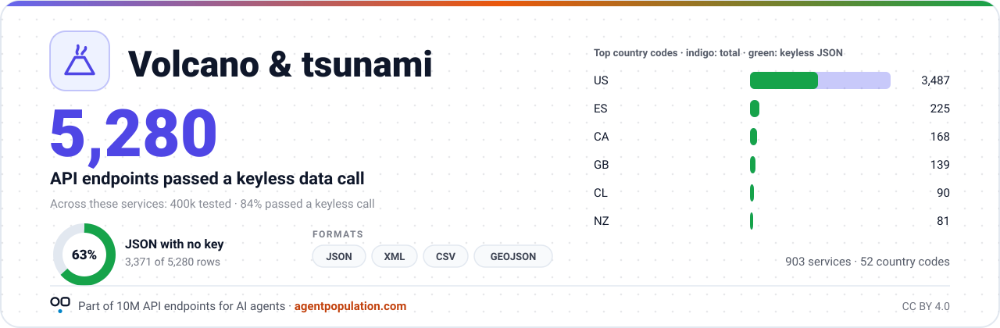
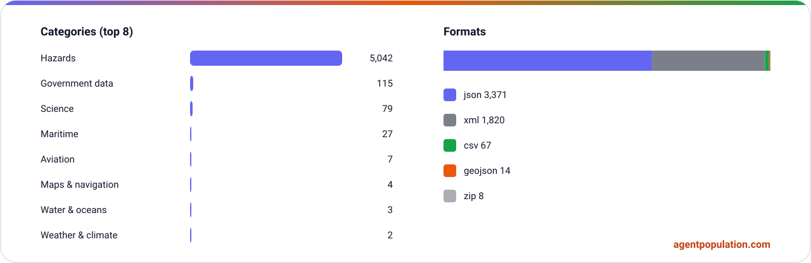

<p align="center"></p>

# 🌋 Volcano and tsunami API endpoints

**5,280 volcano and tsunami API endpoints that answered a keyless GET with a data body. For agent and app builders.**

<p align="center"><a href="#files"></a> <a href="#columns-and-tags"></a> <a href="#whats-inside"></a> <a href="#whats-inside"></a> <a href="LICENSE"></a></p>

<p align="center"><a href="#whats-in-it-for-you">What's in it</a> · <a href="#for-ai-agents">For AI agents</a> · <a href="#quick-start">Quick start</a> · <a href="#test-it-yourself">Test it yourself</a> · <a href="#files">Files</a> · <a href="#licence-and-credit">Licence</a> · <a href="#part-of-10m-api-endpoints-for-ai-agents">More packs</a></p>

This repository holds a 1,000-row sample and the services list; the full list of 5,280 endpoints is one download from the [latest release](https://github.com/agentpopulation/5.2k-volcano-tsunami-apis-for-agents/releases/latest).

**Endpoints for building a volcano and tsunami hazard lookup.** Volcano locations, lava-flow and lahar hazard zones, eruption histories, tsunami evacuation and inundation zones, tsunami stations and NOAA tsunami model grids, as URLs that answered with no key on their test date.

Selection rule: rows where `tags has volcanoes OR tags has tsunami`, less the rows that a leave-out rule drops (each counted under Known limits).

4,149 of these 5,280 rows match the focus rule (below); the others are in the pack by the selection rule only, and Known limits says what they are. 2,819 rows (53.4%) are map layers on ArcGIS Online, where anyone can publish.

## In plain words

**What is an API endpoint?** An API endpoint is one web address that a program can ask for data, for example the latest reading at one weather station. A single service, such as a national weather agency, can have thousands of endpoints: one per station, city or dataset. This pack counts endpoints, not separate services.

**What does "passed a data call" mean?** On the date shown in each row, AgentPopulation sent one plain request to that address, with no password or key, and got a non-empty data body back (JSON, CSV, XML or a file): not an error page and not an empty result. Some bodies describe a dataset rather than hold its values; see Known limits. It shows the address answered with data on that day. It is not a promise that it answers today, and licences and usage limits were not reviewed.

## What's in it for you

Four ways to use this pack. Each bucket gives a count, a filter you can apply to the CSV, one example that passed, and a list of recommended starting points with the rule that picked them. Buckets overlap; a row can fit more than one.

Examples, recommended lists and the preview are drawn from rows that match this pack's focus rule, so a row that the selection rule put in this pack but that is about something else is not shown as a starting point. Counts cover the whole bucket.

<details>
<summary>The focus rule</summary>

Focus rule: `title matches /volcan|volcán|vulcan|vulkan|tsunami|tsunamis|eruption|erupci|éruption|lava[ _]?flow|lavaflow|tephra|ash ?fall|caldera|magma|lahar|pyroclast|kilauea|kīlauea|津波|火山/i AND NOT title matches /^NWS (latest observation|zone forecast)/i AND NOT title matches /\bbirds?\b|non-volcanic|sulfur-cycle|newer volcanic|bathym|phytoplankt|schematic/i`

</details>

### 🤖 Agent tools: Volcano, lahar and tsunami-zone layers an agent can query

**2,399** endpoints from 722 services · Wrap one ArcGIS layer as a get_hazard_zone tool: pass a point as `geometry=lon,lat&geometryType=esriGeometryPoint&spatialRel=esriSpatialRelIntersects` and return the tsunami evacuation, lava-flow or lahar zone it falls in, with a timeout; CKAN, Socrata and OpenDataSoft rows return the zone table without a point filter.

2,205 of these are map-layer queries that asked for a few records (`resultRecordCount`); raise it or page through for the whole layer.

Start with: `tags has agent-ready AND title matches /volcan|volcán|vulcan|vulkan|tsunami|tsunamis|eruption|erupci|éruption|lava[ _]?flow|lavaflow|tephra|ash ?fall|caldera|magma|lahar|pyroclast|kilauea|kīlauea|津波|火山/i AND NOT title matches /^NWS (latest observation|zone forecast)/i AND NOT title matches /\bbirds?\b|non-volcanic|sulfur-cycle|newer volcanic|bathym|phytoplankt|schematic/i AND NOT url contains "/erddap/info/"`

Example: [Projecting community changes in hazard exposure t…](https://doi.org/10.5066/F70G3HB8) · Doi · passed 2026-11-15

<details>
<summary>Recommended starting points: 8 services, picked by the stated criteria inside</summary>

**Recommended starting points.** Selected by stated criteria, not a ranking of quality: Services in this pack with the most endpoints that match this bucket and are tagged `agent-ready` (no key sent in the test call, JSON body, passed a data call). Ties go to the service with more country codes, then by name. Only services with at least one bucket row that matches the focus rule are listed, and the sample comes from those rows; the counts cover the whole bucket. The sample URL is the first row by URL sort after preferring, in this order: rows that match the bucket's sample preference when it has one, rows that return values rather than describe a dataset or a service (not ERDDAP /info/ pages, OGC GetCapabilities requests, bare OWS addresses, PxWeb tables, UN SDG series lists, Statistics Canada download pointers, WorldPop listings, GTFS validation reports, untitled rows or service root addresses), and agent-ready rows. Sample preference in this bucket: `NOT url matches ///(services[0-9]*(-[a-z0-9]+)?|utility)\.arcgis\.com//i AND title matches /evacuat|hazard|inundation|eruption|lahar/i`. Services named "ArcGIS organization" hold map layers from many owners and are added only when fewer than 5 other services match.

| Service (host) | Endpoints in bucket | In pack | Country codes in bucket | Formats in bucket | Sample URL that passed |
|---|---:|---:|---|---|---|
| Doi (doi.org) | 107 | 176 | global or unknown | json | [Projecting community changes in hazard …](https://doi.org/10.5066/F70G3HB8) (2026-11-15) |
| Toronto District School Board (ArcGIS Online) (services2.arcgis.com) | 66 | 67 | CA | json | [Buffer\_of\_1700\_Cascadia\_earthquake\_and\_…](https://services2.arcgis.com/PuP9I73SXDqGc9Kp/arcgis/rest/services/Buffer_of_1700_Cascadia_earthquake_and_tsunami_%28Disasters%29/FeatureServer/0/query?where=1%3D1&outFields=*&returnGeometry=false&resultRecordCount=5&f=json) (2026-11-14) |
| ArcGIS Online for Ontario Schools (ArcGIS Online) (services.arcgis.com) | 51 | 53 | CA, FR, US | json | [100\_Buffer\_of\_World\_Volcanoes](https://services.arcgis.com/QI0dObYawrKkuwDp/arcgis/rest/services/100_Buffer_of_World_Volcanoes/FeatureServer/0/query?where=1%3D1&outFields=*&returnGeometry=false&resultRecordCount=5&f=json) (2026-11-15) |
| Oregon ArcGIS Online (ArcGIS Online) (services.arcgis.com) | 29 | 29 | US | json | [1996\_Tsunami\_Inundation\_Zone\_Line](https://services.arcgis.com/uUvqNMGPm7axC2dD/arcgis/rest/services/1996_Tsunami_Inundation_Zone_Line/FeatureServer/0/query?where=1%3D1&outFields=*&returnGeometry=false&resultRecordCount=5&f=json) (2026-11-15) |
| Noaa (gis.ngdc.noaa.gov) | 28 | 28 | US | json | [Global Natural Hazards Data - Tsunami E…](https://gis.ngdc.noaa.gov/arcgis/rest/services/web_mercator/hazards/MapServer/1/query?where=1%3D1&outFields=*&returnGeometry=false&resultRecordCount=5&f=json) (2026-11-15) |
| NIRD Research Data Archive (data.archive.sigma2.no) | 19 | 58 | NO | json | [Arctic warming from a high-latitude eff…](https://data.archive.sigma2.no/dataset/5e575d76-e7fb-4447-9f65-f5d127bf2234/download/dataset_metadata_10.11582_2025.00010.json) (2026-11-15) |
| Stanford University (ArcGIS Online) (services.arcgis.com) | 18 | 23 | BR, US | json | [ArcGIS Online org 7CRlmWNEbeCqEJ6a: vol…](https://services.arcgis.com/7CRlmWNEbeCqEJ6a/ArcGIS/rest/services/volcanoxys/FeatureServer/0/query?where=1%3D1&outFields=*&resultRecordCount=10&f=json) (2026-11-15) |
| MOE-EduGIS (ArcGIS Online) (services5.arcgis.com) | 14 | 16 | SG, US | json | [8 selected volcanoes](https://services5.arcgis.com/XqaKEQIgV03geG0E/arcgis/rest/services/8_selected_volcanoes/FeatureServer/0/query?where=1%3D1&outFields=*&returnGeometry=false&resultRecordCount=5&f=json) (2026-11-14) |

</details>

### 📱 App features: Tsunami evacuation zones, safe areas and volcanic hazard maps for a safety app

**464** endpoints from 190 services · Draw evacuation zones, assembly points and hazard areas on a map card; show the zone a user stands in and the nearest safe area, with the layer date.

Start with: `title matches /volcan|volcán|vulcan|vulkan|tsunami|tsunamis|eruption|erupci|éruption|lava[ _]?flow|lavaflow|tephra|ash ?fall|caldera|magma|lahar|pyroclast|kilauea|kīlauea|津波|火山/i AND title matches /evacua|inundation|safe (zone|area|location)|assembly|encuentro|encontro|siren|notification|lahar|lava[ _]?flow|lavaflow|volcanic hazard|volcano hazard|hazard (zone|area|line)/i AND NOT url contains "/erddap/info/"`

Example: [Tsunami Evacuation Travel Time Map for Del Norte …](https://data.usgs.gov/datacatalog/metadata/USGS.589110f3e4b072a7ac116b93.xml) · Usgs · passed 2026-11-15

<details>
<summary>Recommended starting points: 8 services, picked by the stated criteria inside</summary>

**Recommended starting points.** Selected by stated criteria, not a ranking of quality: Services in this pack with the most endpoints that match this bucket and passed a data call. Ties go to the service with more country codes, then by name. Only services with at least one bucket row that matches the focus rule are listed, and the sample comes from those rows; the counts cover the whole bucket. The sample URL is the first row by URL sort after preferring, in this order: rows that match the bucket's sample preference when it has one, rows that return values rather than describe a dataset or a service (not ERDDAP /info/ pages, OGC GetCapabilities requests, bare OWS addresses, PxWeb tables, UN SDG series lists, Statistics Canada download pointers, WorldPop listings, GTFS validation reports, untitled rows or service root addresses), and agent-ready rows. Sample preference in this bucket: `NOT url matches ///(services[0-9]*(-[a-z0-9]+)?|utility)\.arcgis\.com//i`. Services named "ArcGIS organization" hold map layers from many owners and are added only when fewer than 5 other services match.

| Service (host) | Endpoints in bucket | In pack | Country codes in bucket | Formats in bucket | Sample URL that passed |
|---|---:|---:|---|---|---|
| Usgs (data.usgs.gov) | 70 | 1,767 | US | xml | [Tsunami Evacuation Travel Time Map for …](https://data.usgs.gov/datacatalog/metadata/USGS.589110f3e4b072a7ac116b93.xml) (2026-11-15) |
| Stanford University (ArcGIS Online) (services.arcgis.com) | 14 | 23 | BR, US | json | [lava\_flow\_hazard\_zones\_my](https://services.arcgis.com/7CRlmWNEbeCqEJ6a/arcgis/rest/services/lava_flow_hazard_zones/FeatureServer/0/query?where=1%3D1&outFields=*&returnGeometry=false&resultRecordCount=5&f=json) (2026-11-14) |
| Doi (doi.org) | 12 | 176 | global or unknown | json | [Pedestrian evacuation times for employe…](https://doi.org/10.5066/F7862FNT) (2026-11-15) |
| Porirua City Council (ArcGIS Online) (services1.arcgis.com) | 9 | 9 | NZ | json | [Tsunami Hazard 1000yr Inundation Extent…](https://services1.arcgis.com/kIwRm3UCyRHYbM8a/arcgis/rest/services/Tsunami_Hazard_1000yr_Inundation_Extent_PDP/FeatureServer/0/query?where=1%3D1&outFields=*&returnGeometry=false&resultRecordCount=5&f=json) (2026-11-14) |
| County of Los Angeles (ArcGIS Online) (services.arcgis.com) | 8 | 8 | US | json | [Los Angeles County Tsunami Hazard Areas](https://services.arcgis.com/RmCCgQtiZLDCtblq/arcgis/rest/services/LAC_Tsunami_Hazard_Area/FeatureServer/0/query?where=1%3D1&outFields=*&returnGeometry=false&resultRecordCount=5&f=json) (2026-11-14) |
| ArcGIS Online: Parcels - Honolulu County (Island of Oahu) - GeoJSON (prod-histategis.opendata.arcgis.com) | 7 | 7 | US | json | [Tsunami Safe Zones - GeoJSON](https://prod-histategis.opendata.arcgis.com/api/download/v1/items/01ea0d1b26de44438a84581abc0357f8/geojson?layers=13) (2026-11-15) |
| Oregon ArcGIS Online (ArcGIS Online) (services.arcgis.com) | 7 | 29 | US | json | [1996\_Tsunami\_Inundation\_Zone\_Line](https://services.arcgis.com/uUvqNMGPm7axC2dD/arcgis/rest/services/1996_Tsunami_Inundation_Zone_Line/FeatureServer/0/query?where=1%3D1&outFields=*&returnGeometry=false&resultRecordCount=5&f=json) (2026-11-15) |
| County of Hawaii GIS (ArcGIS Online) (services1.arcgis.com) | 6 | 9 | US | json | [2018\_kilauea\_lava\_flow\_lower\_east\_rift](https://services1.arcgis.com/C2LPusZs5OXNGFDn/arcgis/rest/services/2018_kilauea_lava_flow_lower_east_rift/FeatureServer/0/query?where=1%3D1&outFields=*&returnGeometry=false&resultRecordCount=5&f=json) (2026-11-14) |

</details>

### 🧠 Grounding and data pipelines: Eruption lists, tsunami events, stations and model grids for scheduled loads

**280** endpoints from 67 services · Load eruption and tsunami event lists, station lists and model-grid descriptions on a schedule into your own store, so answers about past events and exposure cite a dated source.

Start with: `title matches /volcan|volcán|vulcan|vulkan|tsunami|tsunamis|eruption|erupci|éruption|lava[ _]?flow|lavaflow|tephra|ash ?fall|caldera|magma|lahar|pyroclast|kilauea|kīlauea|津波|火山/i AND title matches /histor|significant|eruptions?\b|events?\b|holocene|run ?ups?|marigram|DART|tide station|waterlevel|forecast grids|NEOWAVE|EM-DAT|volcano(es)? of the world|global volcan|world volcan/i`

Example: [Wind rose plots for the volcano: 371051 Hromundar…](https://data.usgs.gov/datacatalog/metadata/USGS.58d01869e4b0236b68f53355.xml) · Usgs · passed 2026-11-15

<details>
<summary>Recommended starting points: 8 services, picked by the stated criteria inside</summary>

**Recommended starting points.** Selected by stated criteria, not a ranking of quality: Services in this pack with the most endpoints that match this bucket and passed a data call. Ties go to the service with more country codes, then by name. Only services with at least one bucket row that matches the focus rule are listed, and the sample comes from those rows; the counts cover the whole bucket. The sample URL is the first row by URL sort after preferring, in this order: rows that match the bucket's sample preference when it has one, rows that return values rather than describe a dataset or a service (not ERDDAP /info/ pages, OGC GetCapabilities requests, bare OWS addresses, PxWeb tables, UN SDG series lists, Statistics Canada download pointers, WorldPop listings, GTFS validation reports, untitled rows or service root addresses), and agent-ready rows. Sample preference in this bucket: `NOT url contains "/erddap/info/" AND NOT url matches ///(services[0-9]*(-[a-z0-9]+)?|utility)\.arcgis\.com//i`. Services named "ArcGIS organization" hold map layers from many owners and are added only when fewer than 5 other services match.

| Service (host) | Endpoints in bucket | In pack | Country codes in bucket | Formats in bucket | Sample URL that passed |
|---|---:|---:|---|---|---|
| Usgs (data.usgs.gov) | 75 | 1,767 | US | xml | [Wind rose plots for the volcano: 371051…](https://data.usgs.gov/datacatalog/metadata/USGS.58d01869e4b0236b68f53355.xml) (2026-11-15) |
| Hawaii (pae-paha.pacioos.hawaii.edu) | 32 | 64 | US | json | [ERDDAP PacIOOS: NEOWAVE Regional Tsunam…](https://pae-paha.pacioos.hawaii.edu/erddap/info/neowave_inundation_agana_tumon/index.json) (2026-11-14) |
| NIRD Research Data Archive (data.archive.sigma2.no) | 24 | 58 | NO | csv, json | [Arctic warming from a high-latitude eff…](https://data.archive.sigma2.no/dataset/5e575d76-e7fb-4447-9f65-f5d127bf2234/download/dataset_metadata_10.11582_2025.00010.json) (2026-11-15) |
| Doi (doi.org) | 19 | 176 | global or unknown | json | [GIS shapefiles for Kilauea's episode 61…](https://doi.org/10.5066/F7DN43XR) (2026-11-15) |
| Amerigeo (www.amerigeo.org) | 6 | 12 | global or unknown | csv, json, xml | [World Volcanoes - GeoJSON](https://www.amerigeo.org/api/download/v1/items/2a45f767a6e549bfbe5bf638681f1fac/geojson?layers=0) (2026-11-15) |
| NOAA GeoPlatform (ArcGIS Online) (services2.arcgis.com) | 5 | 12 | US | json | [Historical Tsunami Marigrams](https://services2.arcgis.com/C8EMgrsFcRFL6LrL/arcgis/rest/services/Historical_Marigrams/FeatureServer/0/query?where=1%3D1&outFields=*&returnGeometry=false&resultRecordCount=5&f=json) (2026-11-14) |
| Noaa (gis.ngdc.noaa.gov) | 5 | 28 | US | json | [Global Natural Hazards Data - Tsunami E…](https://gis.ngdc.noaa.gov/arcgis/rest/services/web_mercator/hazards/MapServer/1/query?where=1%3D1&outFields=*&returnGeometry=false&resultRecordCount=5&f=json) (2026-11-15) |
| Unm (edacarc.unm.edu) | 4 | 4 | US | json | [edacarc.unm.edu: EPSCOR/volcanic\_seismi…](https://edacarc.unm.edu/arcgis/rest/services/EPSCOR/volcanic_seismic_events/MapServer/0/query?where=1%3D1&outFields=*&resultRecordCount=10&f=json) (2026-11-15) |

</details>

### 🧪 Evals and testing: Volcano and tsunami layers, portal records and grids to test a hazard tool

**5,280** endpoints · 903 services · 52 country codes · 5 formats · Run your hazard tool against a fixed set of URLs across hosts; check that zone names, volcano names, dates or wave heights parse, and keep last_tested as the baseline for your own re-tests.

Start with: the whole pack

Example: [Projecting community changes in hazard exposure t…](https://doi.org/10.5066/F70G3HB8) · Doi · passed 2026-11-15

<details>
<summary>Recommended starting points: 8 services, picked by the stated criteria inside</summary>

**Recommended starting points.** Selected by stated criteria, not a ranking of quality: Services in this pack that returned the most different formats, then the most endpoints that passed a data call, then by name: a mix of response shapes to test parsers and tool calls. Only services with at least one bucket row that matches the focus rule are listed, and the sample comes from those rows; the counts cover the whole bucket. The sample URL is the first row by URL sort after preferring, in this order: rows that match the bucket's sample preference when it has one, rows that return values rather than describe a dataset or a service (not ERDDAP /info/ pages, OGC GetCapabilities requests, bare OWS addresses, PxWeb tables, UN SDG series lists, Statistics Canada download pointers, WorldPop listings, GTFS validation reports, untitled rows or service root addresses), and agent-ready rows. Services named "ArcGIS organization" hold map layers from many owners and are added only when fewer than 5 other services match.

| Service (host) | Endpoints in bucket | In pack | Country codes in bucket | Formats in bucket | Sample URL that passed |
|---|---:|---:|---|---|---|
| Cascais (dadosabertos.cascais.pt) | 5 | 5 | PT | geojson, csv, json, xml | [Pontos de encontro de tsunami](https://dadosabertos.cascais.pt/dataset/74d9d6d3-d12c-4a2e-aa2b-94e8377edc04/resource/f6c7b517-7663-4f7c-bcd9-2db8cfab5036/download/geocascais-pontosencontrotsunami_20261110_175122.geojson) (2026-11-12) |
| Amerigeo (www.amerigeo.org) | 12 | 12 | global or unknown | csv, json, xml | [World Volcanoes - GeoJSON](https://www.amerigeo.org/api/download/v1/items/2a45f767a6e549bfbe5bf638681f1fac/geojson?layers=0) (2026-11-15) |
| BNPB Data Catalog (geoportal.bantulkab.go.id) | 5 | 5 | ID | xml, zip, csv | [Jumlah Kejadian Bencana Tsunami menurut…](https://geoportal.bantulkab.go.id/geoserver/ows?service=WFS&version=1.0.0&request=GetFeature&typename=statistik%3Astk_Jml_kejadian_bencana_tsunami_mnrt_kapanewon&outputFormat=gml2&srs=EPSG%3A4326) (2026-11-15) |
| ArcGIS Online: Vegetation (data-cdfw.opendata.arcgis.com) | 3 | 3 | US | csv, json, xml | [Vegetation - Lassen Volcanic National P…](https://data-cdfw.opendata.arcgis.com/api/download/v1/items/fd34c0a488b2469a8b582e5214c02cec/geojson?layers=0) (2026-11-15) |
| Hawaii (pae-paha.pacioos.hawaii.edu) | 64 | 64 | US | json, xml | [ERDDAP PacIOOS: NEOWAVE Regional Tsunam…](https://pae-paha.pacioos.hawaii.edu/erddap/info/neowave_inundation_agana_tumon/index.json) (2026-11-14) |
| NIRD Research Data Archive (data.archive.sigma2.no) | 58 | 58 | NO | csv, json | [NorESM output prepared for VOLCANOES4FU…](https://data.archive.sigma2.no/dataset/0276536f-4672-4b42-a9f5-18b120220947/download/dataset_metadata_10.11582_2017.00002.json) (2026-11-15) |
| Hawaii (geodata.hawaii.gov) | 11 | 11 | US | json, xml | [Tsunami Wave Heights](https://geodata.hawaii.gov/arcgis/rest/services/Hazards/MapServer/1/query?where=1%3D1&outFields=*&returnGeometry=false&resultRecordCount=5&f=json) (2026-11-14) |
| Lacity (data.lacity.org) | 3 | 3 | US | json, xml | [Tsunami Evacuation Signs](https://data.lacity.org/resource/cbxc-q4bc.json?$limit=1) (2026-11-11) |

</details>

The same lists are in [recommended.json](recommended.json), ready for an agent to load.

## Questions an agent can answer with this pack

- What year, explosivity (VEI) and death toll does the significant-eruptions table give for an eruption? Try [significant-volcanic-eruptions](https://openenergyhub.ornl.gov/api/explore/v2.1/catalog/datasets/significant-volcanic-eruptions/records?limit=1) (Ornl, passed 2026-11-12).
- What does the DART station table give for a deep-ocean tsunami detection station? Try [deep-ocean-assessment-and-reporting-of-tsunamis-d…](https://openenergyhub.ornl.gov/api/explore/v2.1/catalog/datasets/deep-ocean-assessment-and-reporting-of-tsunamis-dart-stations/records?limit=1) (Ornl, passed 2026-11-12).
- What volcanic hazard area records does Pierce County, Washington, publish? The tested URL asks for one record; raise `$limit` for more. Try [Volcanic Hazards](https://open.piercecountywa.gov/resource/f28k-ykw8.json?$limit=1) (Piercecountywa, passed 2026-11-12).

## What "passed a data call" means

> [!NOTE]
> On the date in `last_tested` (IST), one GET to the URL, sent with no key, returned HTTP 2xx and a non-empty data body. HTML pages and empty results did not pass. The `format` column records what came back. This is a test result for that date, not a promise that the URL answers today. Licences, terms, rate limits, accuracy and freshness were not reviewed. Endpoints are URLs, not separate APIs; many share one service. This pack was tested 10–15 Nov 2026; snapshot 15 Nov 2026.

## For AI agents

Start from keyless JSON endpoints (`agent-ready`). The code below loads `recommended.json` and calls the first recommended service in the Agent tools bucket, with a timeout (`node examples/agent-start.mjs --recommended`). With no argument, `node examples/agent-start.mjs` calls the most recently tested agent-ready row of the sample; pass a `.csv` or `.csv.gz` path to use that file instead. See [examples/agent-start.mjs](examples/agent-start.mjs).

```js
// Node 18+. Loads recommended.json (the local copy, or the raw file on GitHub) and calls one keyless JSON endpoint.
import fs from 'node:fs';

const RAW = 'https://raw.githubusercontent.com/agentpopulation/5.2k-volcano-tsunami-apis-for-agents/main/recommended.json';
const rec = fs.existsSync('recommended.json')
  ? JSON.parse(fs.readFileSync('recommended.json', 'utf8'))
  : await (await fetch(RAW)).json();

const pick = rec.buckets.find((b) => b.id === 'agent').services[0];
try {
  const res = await fetch(pick.sample_url, {
    headers: { 'User-Agent': 'agent-example/1.0' },
    signal: AbortSignal.timeout(15000),
  });
  console.log(pick.service, res.status, res.headers.get('content-type'));
  console.log((await res.text()).slice(0, 300));
} catch (err) {
  console.log(`did not answer now; last passed ${pick.sample_last_tested} (${err.message})`);
}
```

How an agent picks an endpoint:

1. Filter to `agent-ready` and your country or topic.
2. Prefer the newest `last_tested` and the larger services.
3. Call with a timeout and check the body before you use it.

## Quick start

The examples run against the sample in `data/` out of the box (1,000 rows). Each takes an optional path to a `.csv` or `.csv.gz` file instead.

```bash
git clone https://github.com/agentpopulation/5.2k-volcano-tsunami-apis-for-agents.git
cd 5.2k-volcano-tsunami-apis-for-agents
python examples/quickstart.py
node examples/quickstart.mjs
node examples/agent-start.mjs
```

Full list: download `Volcano_Tsunami_API_Endpoints_AgentPopulation_Snapshot_2026-11-15.csv.gz` (5,280 rows, 261.3 kB) from [releases/latest](https://github.com/agentpopulation/5.2k-volcano-tsunami-apis-for-agents/releases/latest), then gunzip it and pass its path. The scripts also read the `.csv.gz` as it is.

```bash
gunzip Volcano_Tsunami_API_Endpoints_AgentPopulation_Snapshot_2026-11-15.csv.gz
python examples/quickstart.py Volcano_Tsunami_API_Endpoints_AgentPopulation_Snapshot_2026-11-15.csv
node examples/quickstart.mjs Volcano_Tsunami_API_Endpoints_AgentPopulation_Snapshot_2026-11-15.csv
```

### curl

Quote the URL: some contain commas.

```bash
curl -sL "https://raw.githubusercontent.com/agentpopulation/5.2k-volcano-tsunami-apis-for-agents/main/data/Volcano_Tsunami_API_Endpoints_AgentPopulation_Sample.csv" | head -n 4
curl -s --max-time 15 "https://doi.org/10.5066/F70G3HB8" | head -c 600
```

### Python

Standard library only: [examples/quickstart.py](examples/quickstart.py) reads the sample, or the path you pass, keeps agent-ready rows and calls the most recently tested one.

<details>
<summary>The code</summary>

```python
# Python 3, standard library only. Run from a clone of this repository:
#   python examples/quickstart.py [path]
# With no path it reads the sample in data/. Pass the full list from the latest release (.csv or .csv.gz) instead.
# Keeps agent-ready rows and calls the most recently tested one.
import csv
import gzip
import os
import re
import sys
import urllib.request

HERE = os.path.dirname(os.path.abspath(__file__))
path = sys.argv[1] if len(sys.argv) > 1 else os.path.join(HERE, "..", "data", "Volcano_Tsunami_API_Endpoints_AgentPopulation_Sample.csv")
opener = gzip.open if path.endswith(".gz") else open
with opener(path, "rt", newline="", encoding="utf-8") as f:
    rows = list(csv.DictReader(f))

agent = [r for r in rows if "agent-ready" in r["tags"].split("|")]
# Newest test date first; URLs that describe a dataset or a service rather than return values go last.
DESCRIBES = re.compile(r"/erddap/info/|action-report\.json$|[?&]request=getcapabilities|/GeoArea/[^/?]+/List|getFullTableDownloadCSV|hub\.worldpop\.org", re.I)
agent.sort(key=lambda r: r["last_tested"], reverse=True)
agent.sort(key=lambda r: 1 if DESCRIBES.search(r["url"]) else 0)
print(len(rows), "rows,", len(agent), "agent-ready")
if not agent:
    sys.exit(0)

row = agent[0]
req = urllib.request.Request(row["url"], headers={"User-Agent": "agent-example/1.0"})
try:
    with urllib.request.urlopen(req, timeout=15) as res:
        body = res.read(1_000_000).decode("utf-8", "replace")
        print(res.status, res.headers.get("Content-Type"))
        print(body[:300])
except Exception as err:
    print(f"did not answer now; last passed {row['last_tested']} ({err})")
```

</details>

### JavaScript

Reads the sample as JSON because the CSV has quoted commas.

<details>
<summary>The code</summary>

```js
// Node 18+. Reads the sample as JSON (the CSV has quoted commas), local file first.
import fs from 'node:fs';

const FILE = 'data/Volcano_Tsunami_API_Endpoints_AgentPopulation_Sample.json';
const rows = fs.existsSync(FILE)
  ? JSON.parse(fs.readFileSync(FILE, 'utf8'))
  : await (await fetch('https://raw.githubusercontent.com/agentpopulation/5.2k-volcano-tsunami-apis-for-agents/main/data/Volcano_Tsunami_API_Endpoints_AgentPopulation_Sample.json')).json();

const row = rows.find((r) => r.tags.includes('agent-ready'));
const res = await fetch(row.url, { headers: { 'User-Agent': 'agent-example/1.0' }, signal: AbortSignal.timeout(15000) });
console.log(res.status, (await res.text()).slice(0, 300));
```

</details>

### Agent tools

[examples/agent-tools.json](examples/agent-tools.json) holds two tool definitions in the shape most tool-calling APIs accept (name, description, JSON Schema); rename `parameters` if yours uses another key. [examples/quickstart.mjs](examples/quickstart.mjs) implements them:

- `find_endpoints` searches the agent-ready rows of the list by words, country code (their format is json). When you load the tools of more than one pack, prefix the names (for example `volcano_tsunami_find_endpoints`) so they do not clash.
- `fetch_endpoint` calls one URL, **refuses any URL that is not in the list** and does not follow redirects. The allowlist is built from the CSV, so a URL injected into a prompt is refused.

The same two tools can sit behind an MCP server.

## Test it yourself

Re-test endpoints from the sample with the same rule: HTTP 2xx and a non-empty body that is not an HTML page. Node 18+, no packages.

```bash
node tools/test-endpoints.mjs
```

It tests the first 50 URLs and prints one line: tested, passed, did not pass. Options: a `.csv` or `.csv.gz` path (the full list from the release), `--limit 50`, `--timeout-ms 10000`, `--out results.csv`. The results file holds `url`, `status`, `passed`, `content_type`, `ms` and `checked_at`; a status of `timeout` or `error:<code>` means no HTTP answer came back. It is polite: GET only, no key sent, at most 4 requests in flight, one at a time per listed host, at least 1 second between requests to one listed host, and reading stops once 256 kB of a body is kept. Redirects are followed and may lead to another host. `results.csv` is in `.gitignore`.

## Preview

One row from each of the five largest services among rows that match the focus rule, services with rows that return values first.

| Title | Service | Country | Format | Tested | Link |
|---|---|---|---|---|---|
| lanai\_vol - Volcanic and Seismic Hazard Intensity Level in … | Usgs | US | xml | 2026-11-15 | [data.usgs.gov](https://data.usgs.gov/datacatalog/metadata/USGS.00edba81-81a5-48da-bfb1-27b7eb506ac8.xml) |
| Projecting community changes in hazard exposure to support … | Doi | global or unknown | json | 2026-11-15 | [doi.org](https://doi.org/10.5066/F70G3HB8) |
| Área Mayor Carillo (Tsunami)\_v1 | ArcGIS Online layers (services3.arcgis.com, org vF5meFYES9JqHHlg) | global or unknown | json | 2026-11-14 | [services3.arcgis.com](https://services3.arcgis.com/vF5meFYES9JqHHlg/arcgis/rest/services/%C3%81rea_Mayor_Carillo_%28Tsunami%292/FeatureServer/0/query?where=1%3D1&outFields=*&returnGeometry=false&resultRecordCount=5&f=json) |
| Buffer\_of\_1700\_Cascadia\_earthquake\_and\_tsunami\_(Disasters) | Toronto District School Board (ArcGIS Online) | CA | json | 2026-11-14 | [services2.arcgis.com](https://services2.arcgis.com/PuP9I73SXDqGc9Kp/arcgis/rest/services/Buffer_of_1700_Cascadia_earthquake_and_tsunami_%28Disasters%29/FeatureServer/0/query?where=1%3D1&outFields=*&returnGeometry=false&resultRecordCount=5&f=json) |
| NorESM output prepared for VOLCANOES4FUTURE - NO-VOLC refer… | NIRD Research Data Archive | NO | json | 2026-11-15 | [data.archive.sigma2.no](https://data.archive.sigma2.no/dataset/0276536f-4672-4b42-a9f5-18b120220947/download/dataset_metadata_10.11582_2017.00002.json) |

Browse the 1,000-row sample: [Sample CSV](data/Volcano_Tsunami_API_Endpoints_AgentPopulation_Sample.csv) · [Sample JSON](data/Volcano_Tsunami_API_Endpoints_AgentPopulation_Sample.json).

## What's inside

<p align="center"></p>

<details>
<summary>Country codes: 52</summary>

| Code | Country | Endpoints | |
|---|---|---:|---|
| US | United States | 3,487 | `████████████████████` |
| ES | Spain | 225 | `█▎` |
| CA | Canada | 168 | `█` |
| GB | United Kingdom | 139 | `▊` |
| CL | Chile | 90 | `▌` |
| NZ | New Zealand | 81 | `▌` |
| NO | Norway | 66 | `▍` |
| FR | France | 49 | `▎` |
| JP | Japan | 38 | `▎` |
| AU | Australia | 30 | `▏` |
| | other 42 codes | 261 | |
| | global or unknown | 646 | `███▊` |

</details>

<details>
<summary>Categories: top 8</summary>

| Category | Endpoints | |
|---|---:|---|
| Hazards | 5,042 | `████████████████████` |
| Government & Open Data | 115 | `▌` |
| Science | 79 | `▍` |
| Maritime | 27 | `▏` |
| Aviation | 7 | `▏` |
| Navigation & Geo/Maps | 4 | `▏` |
| Hydrology & Oceans | 3 | `▏` |
| Weather & Climate | 2 | `▏` |

</details>

Formats: json 3,371 · xml 1,820 · csv 67 · geojson 14 · zip 8

<details>
<summary>Largest services: top 25 of 903</summary>

| Service | Host | Endpoints | Keyless JSON | |
|---|---|---:|---:|---|
| Usgs | data.usgs.gov | 1,767 | 0 | `████████████████████` |
| Doi | doi.org | 176 | 176 | `██` |
| ArcGIS Online layers (services3.arcgis.com, org vF5meFYES9JqHHlg) | services3.arcgis.com | 112 | 112 | `█▎` |
| Cabildo Insular de La Palma (ArcGIS Online) | services.arcgis.com | 69 | 69 | `▊` |
| Toronto District School Board (ArcGIS Online) | services2.arcgis.com | 67 | 67 | `▊` |
| Hawaii | pae-paha.pacioos.hawaii.edu | 64 | 32 | `▊` |
| NIRD Research Data Archive | data.archive.sigma2.no | 58 | 20 | `▋` |
| ArcGIS Online layers (services7.arcgis.com, org UeyripQFTg6pfUe5) | services7.arcgis.com | 56 | 56 | `▋` |
| ArcGIS Online for Ontario Schools (ArcGIS Online) | services.arcgis.com | 53 | 53 | `▋` |
| Eoapi † | stac.eoapi.dev | 46 | 42 | `▌` |
| MapAction (ArcGIS Online) | services2.arcgis.com | 43 | 43 | `▌` |
| ArcGIS Online layers (services2.arcgis.com, org IsDCghZ73NgoYoz5) | services2.arcgis.com | 38 | 38 | `▍` |
| ArcGIS Online layers (services2.arcgis.com, org cRH3tEMPESJz6DMX) | services2.arcgis.com | 37 | 37 | `▍` |
| ArcGIS Online layers (services5.arcgis.com, org RbjlVNAtGGPx1hPV) | services5.arcgis.com | 32 | 32 | `▍` |
| ArcGIS Online layers (services9.arcgis.com, org EGheeB0VDT6EarZv) | services9.arcgis.com | 30 | 30 | `▍` |
| Oregon ArcGIS Online (ArcGIS Online) | services.arcgis.com | 29 | 29 | `▍` |
| ArcGIS Online layers (services5.arcgis.com, org W1uyphp8h2tna3qJ) | services5.arcgis.com | 28 | 28 | `▍` |
| Noaa | gis.ngdc.noaa.gov | 28 | 28 | `▍` |
| ArcGIS Online layers (services3.arcgis.com, org vQ3OYhyPnynK3Zqb) | services3.arcgis.com | 24 | 24 | `▎` |
| Stanford University (ArcGIS Online) | services.arcgis.com | 23 | 23 | `▎` |
| ArcGIS Online layers (services3.arcgis.com, org EkiZXsKUjcuTmRZG) | services3.arcgis.com | 22 | 22 | `▎` |
| Opentopography † | portal.opentopography.org | 22 | 22 | `▎` |
| U.S. Geological Survey (ArcGIS Online) | services.arcgis.com | 20 | 20 | `▎` |
| ArcGIS Online layers (services5.arcgis.com, org vTs6mag4EJANhVTW) | services5.arcgis.com | 20 | 20 | `▎` |
| Royal High School Bath (ArcGIS Online) | services1.arcgis.com | 19 | 19 | `▎` |

† No row of these services matches the focus rule: the selection rule put them in this pack, so they are not used as a starting point.

</details>

<details>
<summary>Rows per test date: 10–15 Nov 2026</summary>

| Date (IST) | Endpoints | |
|---|---:|---|
| 2026-11-15 | 3,287 | `████████████████████` |
| 2026-11-14 | 1,962 | `████████████` |
| 2026-11-13 | 4 | `▏` |
| 2026-11-12 | 22 | `▏` |
| 2026-11-11 | 4 | `▏` |
| 2026-11-10 | 1 | `▏` |

</details>

## Files

| File | Rows | Size | Use |
|---|---:|---:|---|
| [data/Volcano_Tsunami_API_Services_AgentPopulation.csv](data/Volcano_Tsunami_API_Services_AgentPopulation.csv) | 903 | 56.5 kB | One row per service with its endpoint count in this pack |
| [data/Volcano_Tsunami_API_Endpoints_AgentPopulation_Sample.csv](data/Volcano_Tsunami_API_Endpoints_AgentPopulation_Sample.csv) | 1,000 | 303.5 kB | The sample: focus-rule rows first, each service in proportion to its share; ArcGIS Online layers count as one service |
| [data/Volcano_Tsunami_API_Endpoints_AgentPopulation_Sample.json](data/Volcano_Tsunami_API_Endpoints_AgentPopulation_Sample.json) | 1,000 | 503.0 kB | The same rows as JSON, tags as an array |
| [Volcano_Tsunami_API_Endpoints_AgentPopulation_Snapshot_2026-11-15.csv.gz](https://github.com/agentpopulation/5.2k-volcano-tsunami-apis-for-agents/releases/latest) | 5,280 | 261.3 kB | The full list, gzipped CSV: a download from the latest release, checked by `SHA256SUMS.txt` |
| [tools/test-endpoints.mjs](tools/test-endpoints.mjs) | | | Re-tests endpoints from the sample or the full list |

Sample size: 1,000 rows, which is 1,000 or one third of the pack rounded down, whichever is smaller. Rows that match the focus rule come first. Each service gets rows in proportion to its share of those rows, at least one for the largest services and at most 50% of the sample while other services have rows; ArcGIS Online layers count as one service, whatever their organisation. Within a service, agent-ready rows, rows that return values and the newest test dates come first, and rows are written in turn across services. Service root addresses are placed at the end of the sample.

Full list: download `Volcano_Tsunami_API_Endpoints_AgentPopulation_Snapshot_2026-11-15.csv.gz` (5,280 rows, 261.3 kB) from [releases/latest](https://github.com/agentpopulation/5.2k-volcano-tsunami-apis-for-agents/releases/latest), then gunzip it and pass its path. The scripts also read the `.csv.gz` as it is.

Excel users: Data > From Text/CSV, UTF-8. Files are UTF-8 without a byte-order mark and comma-separated.

## Columns and tags

<details>
<summary>Columns, types and tags</summary>

| Column | Type | Example | Meaning |
|---|---|---|---|
| url | string | [https://data.usgs.gov/datacatalog/metad…](https://data.usgs.gov/datacatalog/metadata/USGS.00edba81-81a5-48da-bfb1-27b7eb506ac8.xml) | The address that was tested |
| title | string | lanai\_vol - Volcanic and Seismic Hazard… | Station, dataset or feed name |
| service | string | Usgs | The service the endpoint belongs to; joins to the services file together with host |
| host | string | data.usgs.gov | Host name of the address |
| country | string | US | ISO 3166-1 alpha-2 code, or EU; empty when global or unknown |
| category | string | Hazards | Category of the endpoint |
| subcategory | string |  | Left empty from the 15 Nov 2026 snapshot; kept so the columns stay the same |
| format | string | xml | What the test call returned: json, csv, geojson, xml, gtfs, zip, txt and so on |
| tags | string | `hazards\|earthquakes\|volcanoes\|open-data…` | Tags separated by \| |
| last_tested | date | 2026-11-15 | Date of the test call, YYYY-MM-DD (IST) |

| Tag | Rows | Meaning |
|---|---:|---|
| no-key | 5,280 | No key was sent in the test call |
| hazards | 5,075 | Topic tag |
| volcanoes | 3,840 | Topic tag |
| agent-ready | 3,371 | No key sent, JSON body, passed a data call on last_tested |
| json | 3,371 | Format of the body |
| maps | 3,088 | Topic tag |
| open-data | 2,196 | Topic tag |
| xml | 1,820 | Format of the body |
| tsunami | 1,454 | Topic tag |
| earthquakes | 468 | Topic tag |
| science | 151 | Topic tag |
| government | 140 | Topic tag |
| csv | 67 | Format of the body |
| oceans | 64 | Topic tag |
| transit | 63 | Topic tag |
| rivers | 54 | Topic tag |
| statistics | 52 | Topic tag |
| elevation | 49 | Topic tag |
| weather | 46 | Topic tag |
| maritime | 39 | Topic tag |
| groundwater | 30 | Topic tag |
| tides | 22 | Topic tag |
| finance | 21 | Topic tag |
| economy | 16 | Topic tag |
| climate | 15 | Topic tag |
| geojson | 14 | Format of the body |
| environment | 12 | Topic tag |
| floods | 9 | Topic tag |
| aviation | 7 | Topic tag |
| energy | 6 | Topic tag |
| health | 6 | Topic tag |
| water | 3 | Topic tag |
| forecast | 2 | Topic tag |
| parking | 1 | Topic tag |
| speech | 1 | Topic tag |

A machine-readable copy of this dictionary is in [datapackage.json](datapackage.json).

</details>

## Known limits

- 66.0% of rows carry country code US; 646 rows have no code (global or unknown).
- 32 rows are ERDDAP /info/ pages: they describe a dataset rather than return its values, so the series needs a second request.
- 2,968 rows are map-layer queries with resultRecordCount set: the tested call asked for a few records; change the query to get the full layer.
- 15 rows carry limit=1: the tested call asked for one record; raise the limit or page through.
- 30 rows are open-data portal dataset records, which may return a dataset record with links rather than the table itself.
- 8 rows are files (zip 8) rather than bodies an agent reads directly.
- 2,819 rows are layers on ArcGIS Online, where anyone can publish: some are class projects, tests or copies. Check the owner and the fields before you rely on one.
- 1,110 rows carry the volcanoes or tsunami tag but have no volcano, eruption, lava or tsunami term in the title. Check the title before you use one; they are not used as starting points.
- 21 rows name a volcano or volcanic ground in the title but hold something else: seabed surveys, soil, bird and plankton studies, a diagram, and rock layers of the Newer Volcanics formation in Australia.
- 468 rows also carry the earthquakes tag, so they are in the Earthquakes pack too.
- 22 rows from New Zealand (.nz) or Canadian (.ca) hosts carry another country code (GB or US) in this snapshot; filter by host when you need one country.
- Stations and feeds can go quiet after their test date; re-test a URL before you rely on it.
- Not in this pack: endpoints that need a key or a POST, and URLs that did not pass.
- Left out: 69 ArcGIS Survey123 layers (they can hold people's form answers).
- Left out: 609 class-exercise copies of the same few ArcGIS Online layers (Miami Beach sea level rise, high-risk areas without shelter, flooded areas, sea level rise and storm surge maps) across many organisations, many with a person's name in the title.
- Left out: 4 ArcGIS layers that keep a form's default service name (they can hold people's form answers).
- Left out: 39 ArcGIS class or coursework layers (lab, assignment, exam, quiz, lesson, exercise, tutorial and final-project layers, copies of class layers, layers named for a person or a person's home, and layers whose name ends in a person's name or holds a student number).
- Left out: 2 ArcGIS layers that hold reports, comments, submissions or form responses sent in by the public.
- Left out: 6 rows of server information from Mastodon, PeerTube, Lemmy, Nostr and other social network servers (instance documents name the server's contact person).
- Left out: 127 copies of population-distribution and shelter-access layers, many with initials or a person's name added to the title.

## Licence and credit

> [!IMPORTANT]
> This list (URLs, titles, tags and test results) is © 2026 AgentPopulation, released under [CC BY 4.0](https://creativecommons.org/licenses/by/4.0/). Credit AgentPopulation and link agentpopulation.com. The data each endpoint returns belongs to its provider and stays under that provider's terms; this licence does not cover it.

Copy-ready credit:

`Volcano and tsunami API endpoints by AgentPopulation (https://agentpopulation.com), CC BY 4.0, snapshot 15 Nov 2026.`

GitHub's "Cite this repository" button reads [CITATION.cff](CITATION.cff).

<!-- agentpopulation:start -->
## Part of 10M API endpoints for AI agents

This pack is one of the 24 topic packs of [10m-open-apis-for-ai-agents](https://github.com/agentpopulation/10m-open-apis-for-ai-agents), the open collection by [AgentPopulation](https://agentpopulation.com). Target: 10 million+ open API endpoints that pass a keyless API call.

AgentPopulation has tested over 5 million API endpoints: 5,129,834 tested, 3,726,509 passed a data call (snapshot 15 Nov 2026). This is the volcano and tsunami pack: 5,280 endpoints from 903 services. Packs overlap, so an endpoint can appear in more than one.

For the latest tested endpoints, search [agentpopulation.com/apis](https://agentpopulation.com/apis). This pack is a snapshot from 15 Nov 2026.

Sibling packs that share the most URLs with this one: [53k-hazards-apis-for-agents](https://github.com/agentpopulation/53k-hazards-apis-for-agents) (5,042 shared) · [2.5m-agent-ready-apis](https://github.com/agentpopulation/2.5m-agent-ready-apis) (3,371 shared) · [10k-earthquake-apis-for-agents](https://github.com/agentpopulation/10k-earthquake-apis-for-agents) (468 shared) · [270k-water-apis-for-agents](https://github.com/agentpopulation/270k-water-apis-for-agents) (166 shared) · [1.3m-government-open-data-apis](https://github.com/agentpopulation/1.3m-government-open-data-apis) (115 shared) · [380k-science-apis-for-agents](https://github.com/agentpopulation/380k-science-apis-for-agents) (79 shared). The rest are listed in [10m-open-apis-for-ai-agents](https://github.com/agentpopulation/10m-open-apis-for-ai-agents).

Questions, pack requests, reports of endpoints that stopped answering and requests to remove a row go to [Discussions](https://github.com/agentpopulation/10m-open-apis-for-ai-agents/discussions), or to [@agentpopulation](https://x.com/agentpopulation) on X. The packs are a work in progress and corrections are welcome.

Spotted a wrong row or a dead URL? Tell us on X: [@agentpopulation](https://x.com/agentpopulation).

If this pack saved you time, a star helps others find it.

---

Compiled by [AgentPopulation](https://agentpopulation.com) with [AP Desk](https://github.com/agentpopulation/apdesk) · [10m-open-apis-for-ai-agents](https://github.com/agentpopulation/10m-open-apis-for-ai-agents)

<!-- agentpopulation:end -->
